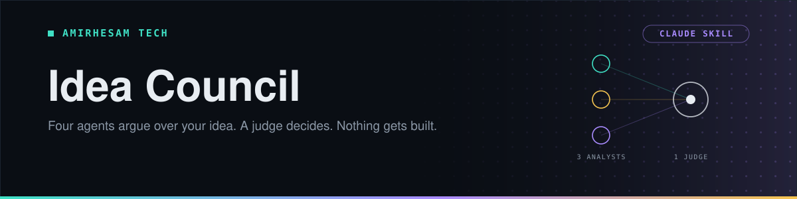

<p align="center">
  
</p>

<p align="center">
       <a href="https://github.com/amirh3sam/idea-council/stargazers"></a>
</p>

<p align="center">
  <a href="#quick-start"><b>Quick start</b></a> ·
  <a href="#how-it-works">How it works</a> ·
  <a href="#the-four-agents">The agents</a> ·
  <a href="#it-will-not-build-anything">The hard stop</a> ·
  <a href="#faq">FAQ</a>
</p>

Ask an AI whether your idea is good and it will usually tell you yes. It is agreeable by default, you clearly want to hear yes, and so you get yes — right up until you have spent three months finding out otherwise.

This fixes that by refusing to let one voice answer. Four agents evaluate your idea: one argues **for** it, one argues **against** it, one works out **whether the money makes sense**, and a fourth **rules on their reports**. The first three never see each other's work, so none of them can soften its position to fit the others.

```
/evaluate a browser extension that blocks doomscrolling
```

- **One command.** Nothing to install, no API key, no dependencies.
- **They work independently**, so disagreement survives to the verdict — which is the part worth reading.
- **Evidence is labelled** Verified, Inferred or Assumed, and invented statistics are forbidden.
- **It cannot build anything.** The tools that would let it are removed, not just discouraged.

## Quick start

You need [Claude Code](https://claude.com/claude-code). Copy the four agents and the skill into your Claude directory.

**For every project on your machine:**

```bash
git clone https://github.com/amirh3sam/idea-council.git
cd idea-council
mkdir -p ~/.claude/agents ~/.claude/skills
cp .claude/agents/*.md ~/.claude/agents/
cp -r .claude/skills/evaluate ~/.claude/skills/
```

**For one project only**, copy the same files into that project's `.claude/` folder instead.

Then open Claude Code and run:

```
/evaluate a meal planner that only uses what is already in your fridge
```

Claude Code picks up new agent and skill files within seconds. If `/evaluate` does not appear, restart the session once — that is only needed the first time an `agents` directory is created.

## How it works

```
                   ┌──────────────┐
            ┌─────▶│   Believer   │─────┐
            │      └──────────────┘     │
┌───────┐   │      ┌──────────────┐     │   ┌─────────┐
│  idea │───┼─────▶│   Skeptic    │─────┼──▶│  Judge  │──▶ verdict
└───────┘   │      └──────────────┘     │   └─────────┘
            │      ┌──────────────┐     │
            └─────▶│   Investor   │─────┘
                   └──────────────┘
              (parallel, cannot see each other)
```

The three analysts run **in parallel, in a single message**, which is what keeps them independent. Each gets only your idea. None of them sees another's findings.

The Judge then receives all three reports **in full** — not summaries, because summarising strips the evidence quality the Judge exists to weigh.

## The four agents

| Agent | Job | Scores |
|---|---|---|
| 🟢 **Believer** | The strongest *honest* case for. Not a cheerleader — an overstated case is discounted by the Judge | How strong the case for is |
| 🔴 **Skeptic** | The strongest case against: who already does this, what killed similar attempts, the costs people forget | How severe the problems are, where **10 is fatal** |
| 🟡 **Investor** | Who pays, how much, what it costs to build and run, how long until it pays back | How good an investment it is |
| 🟣 **Judge** | Weighs evidence quality and rules | The final verdict |

### The Judge does not average the scores

This is the part that makes the output worth reading. Three numbers arrive; the Judge decides **which deserve weight**:

- A **Verified** claim with a working source outweighs a confident assertion.
- A **specific** objection ("Notion already does this, here is the page") outweighs a vague one ("the market is crowded").
- **One fatal flaw outweighs ten small advantages.** A single incumbent giving this away free can end it alone.
- **An agent that found nothing tells you something.** A Skeptic who searched hard and came back with little is strong evidence *for* the idea.

Verdicts are **BUILD**, **BUILD, BUT** (with conditions named), **NOT YET** (with what to learn first), or **DON'T BUILD**. "Maybe, it depends" is treated as a failure to do the job.

## It will not build anything

A BUILD verdict is a conclusion, not permission. The council decides; it does not start work.

That boundary is enforced by configuration, not by asking nicely:

```yaml
# every agent
tools: Read, Glob, Grep, WebSearch, WebFetch
disallowedTools: Write, Edit, NotebookEdit, Bash

# the skill that orchestrates them
disallowed-tools: Write, Edit, NotebookEdit, Bash
```

`tools` is an allowlist, so the agents have no file-writing or shell tool to reach for. The orchestrator has them removed for the duration of the turn. Even "great, go ahead — build it" in the same breath cannot start implementation, because the capability is absent rather than merely discouraged.

> [!NOTE]
> The restriction is scoped to the evaluation only. This repo deliberately ships **no** `settings.json`, because a project-wide deny rule would stop you editing your own code. Copy the agents and the skill, and nothing else about your setup changes.

## Example

```
/evaluate a Chrome extension that summarises long GitHub issues
```

<details>
<summary><b>What comes back</b></summary>

Three reports, then the verdict. Abbreviated here:

**🟢 Believer — 7/10**
Long issue threads are a real, daily cost for maintainers. GitHub's own interface has no summary. *Verified:* several threads in popular repos run past 200 comments. *Assumed:* that maintainers would install a third-party extension for this.

**🔴 Skeptic — 6/10**
GitHub Copilot already summarises issues for Copilot subscribers, which removes a large part of the audience. *Verified:* linked to the feature page. Extension distribution is the real problem — building it is a weekend, getting anyone to install it is not. One objection did not survive: the API rate limits turned out to be generous enough.

**🟡 Investor — 4/10**
Buyer is unclear: maintainers are mostly unpaid and historically do not buy tools. Running cost scales with summarisation calls, so each active user has a real recurring cost against likely zero revenue. *Unknown:* whether any team would pay per seat.

**🟣 Judge — BUILD, BUT**
> This turns on whether an incumbent already covers the audience that would pay.
>
> The Investor's report carried the most weight here, and it was the best evidenced — the Believer's central claim about willingness to install was labelled Assumed, and nothing supported it. The Skeptic's Copilot finding was specific and sourced, which is the kind of objection that decides things.
>
> **Conditions:** ship it free as a portfolio piece, or find one team that will pay per seat before writing code.
>
> **Cheapest next test:** ask five maintainers whether they would install it. A day's work, and it settles the Believer's one unsupported assumption.

</details>

## FAQ

<details>
<summary><b>Does this need an API key or a subscription?</b></summary>

No. It is four Markdown files. They use the Claude Code session you already have, and the agents' own research runs through the web tools Claude Code ships with.

</details>

<details>
<summary><b>Why not just ask Claude "is this a good idea?"</b></summary>

Because you will usually get yes. A single answer has no one disagreeing with it, so there is no pressure on it to be right. Here the Skeptic is rewarded for finding what is wrong, the Believer for finding what is right, and the Judge for noticing which of them actually brought evidence.

</details>

<details>
<summary><b>Will it just reject everything to seem rigorous?</b></summary>

It should not, and the prompts say so directly: dismissing everything is as useless as approving everything. The Skeptic is told to report objections that *did not* survive research, which is evidence in the idea's favour and feeds into the verdict.

</details>

<details>
<summary><b>Can I change what the agents care about?</b></summary>

Yes, that is the point of them being plain Markdown. Edit the file. Add a `designer` who only cares whether it can be made pleasant to use, or a `regulator` for anything touching health or money — then add it to the parallel launch in `SKILL.md`.

</details>

<details>
<summary><b>It answered without running the agents</b></summary>

Check the agent files are in `~/.claude/agents/` (or your project's `.claude/agents/`), and that the skill is at `.claude/skills/evaluate/SKILL.md`. If an agent is missing, the skill says which one and the Judge notes it ruled on an incomplete council rather than inventing the missing report.

</details>

<details>
<summary><b>Can it be wrong?</b></summary>

Of course. It researches the public web, and a confident wrong source is still wrong. That is why every claim is labelled Verified, Inferred or Assumed, and why the Judge names the cheapest next test. Treat it as a structured second opinion, not an oracle.

</details>

## About

Made by **[AmirHesam Tech](https://amirhesamtech.com)**. More tech content on TikTok: [@techwithamirh3sam](https://www.tiktok.com/@techwithamirh3sam).

If this saved you from building the wrong thing, please give it a star. It helps other people find it.
